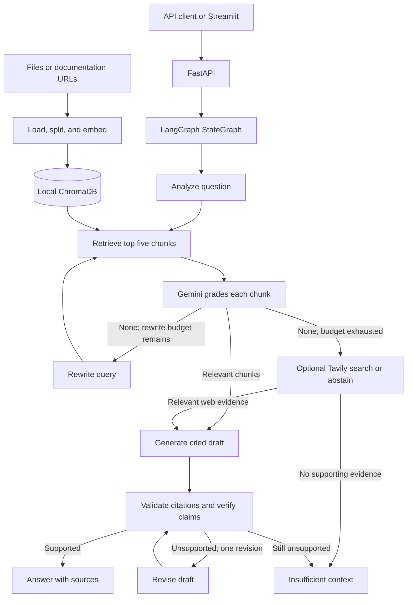

# Know-It

Know-It answers questions about technical documentation with cited sources. It retrieves relevant passages, asks Gemini to grade them, and answers only from approved evidence. When the documents cannot support an answer, it returns `insufficient_context`. The initial corpus is five pages from the official FastAPI documentation, listed in [corpus/seed_urls.json](corpus/seed_urls.json).

## Architecture



The graph keeps the original question, current search query, retrieved chunks, relevance grades, approved chunks, and `rewrite_count` in a typed state. It allows at most two query rewrites. Temporary provider failures use separate bounded node retries, so they do not consume the rewrite budget. Citation IDs must match approved chunks; a groundedness check can revise a draft once before abstaining. Each query starts with fresh graph state.

I keep the boundaries simple: FastAPI handles HTTP validation, ingestion prepares documents, Chroma stores vectors, and LangGraph controls answer routing. Gemini supplies chat responses and embeddings. SQLite stores returned answers, feedback, and up to three completed turns for follow-up questions. Prior chat helps interpret a question but is never treated as evidence. I explain the build sequence in [IMPLEMENTATION_PLAN.md](IMPLEMENTATION_PLAN.md).

## Setup and run

Use Python 3.11 and [uv](https://docs.astral.sh/uv/). Install the locked dependencies and create a local configuration file:

```bash
uv sync --locked
cp .env.example .env
```

On PowerShell, use `Copy-Item .env.example .env` for the second command. Set `GOOGLE_API_KEY` in `.env` for ingestion and queries. The setting accepts one key or comma-separated keys, used in round-robin order; every key must have access to the configured models. To enable optional web fallback, set `TAVILY_API_KEY` and `WEB_FALLBACK_ENABLED=true`. Chroma runs locally at `CHROMA_PATH` and needs no Chroma API key. The `.env` file and local data are ignored by Git.

Seed the five documentation pages, then start the API:

```bash
uv run python -m app.cli seed
uv run uvicorn app.main:app --reload
```

The API is available at `http://127.0.0.1:8000`, with interactive documentation at `/docs`. Seeding again skips unchanged pages. The ingestion endpoint accepts UTF-8 Markdown, plain text, and HTML. For the optional Streamlit UI, run these commands in another terminal:

```bash
uv sync --locked --extra ui
uv run --extra ui streamlit run app/ui.py
```

The UI calls the FastAPI server and does not need the Gemini or Tavily keys itself.

## API examples

The `curl` examples below use Bash syntax. On PowerShell, use the interactive `/docs` page or `Invoke-RestMethod`.

### Ask a question — `POST /query`

```bash
curl -X POST http://127.0.0.1:8000/query \
  -H "Content-Type: application/json" \
  -d '{"question":"How do FastAPI dependencies work?"}'
```

Example response (IDs and text are illustrative):

```json
{
  "answer_id": "93b9c7a6-aa54-4e98-bf00-b3877bc9f185",
  "session_id": "4ef42a80-e0ce-419c-98e5-991b48d092a6",
  "answer": "Declare a callable with Depends to provide a dependency. [S1]",
  "status": "answered",
  "sources": [
    {
      "citation_id": "S1",
      "chunk_id": "chunk-hash",
      "document_id": "document-hash",
      "title": "Dependencies",
      "heading": "Dependencies / Import Depends",
      "source": "https://fastapi.tiangolo.com/tutorial/dependencies/",
      "source_kind": "url",
      "origin": "corpus",
      "excerpt": "FastAPI provides the Depends function..."
    }
  ],
  "rewrite_count": 0,
  "web_attempted": false
}
```

Send the returned `session_id` with a later question to use follow-up memory. An unsupported question returns `status: "insufficient_context"` and an empty `sources` list.

### Add a document — `POST /ingest`

Send exactly one URL or file as multipart form data:

```bash
curl -X POST http://127.0.0.1:8000/ingest \
  -F "url=https://fastapi.tiangolo.com/tutorial/dependencies/"
```

For a file, use `-F "file=@path/to/guide.md;type=text/markdown"` instead of the URL field.

```json
{
  "document_id": "document-hash",
  "title": "Dependencies",
  "source": "https://fastapi.tiangolo.com/tutorial/dependencies/",
  "source_kind": "url",
  "chunk_count": 6,
  "status": "created"
}
```

### List documents — `GET /documents`

```bash
curl http://127.0.0.1:8000/documents
```

```json
{
  "documents": [
    {
      "document_id": "document-hash",
      "title": "Dependencies",
      "source": "https://fastapi.tiangolo.com/tutorial/dependencies/",
      "source_kind": "url",
      "chunk_count": 6,
      "content_hash": "content-hash"
    }
  ],
  "total": 1
}
```

### Rate an answer — `POST /feedback`

Use an `answer_id` returned by `/query`:

```bash
curl -X POST http://127.0.0.1:8000/feedback \
  -H "Content-Type: application/json" \
  -d '{"answer_id":"93b9c7a6-aa54-4e98-bf00-b3877bc9f185","rating":"up","comment":"Useful answer"}'
```

```json
{
  "feedback_id": "7fcaf370-e988-49c7-9a9d-47cd53eb518a",
  "answer_id": "93b9c7a6-aa54-4e98-bf00-b3877bc9f185",
  "accepted": true
}
```

Invalid requests return HTTP 422; an oversized upload returns 413, an unsupported file type returns 415, and feedback for an unknown answer returns 404. Provider or storage failures return a service error rather than a fabricated answer.

## Design decisions and tradeoffs

- **Chunking and embeddings:** I preserve section headings and nearby code, then target 700-token chunks with 80 tokens of overlap for long sections. I embed documents and queries with `gemini-embedding-001` and store their vectors in persistent local Chroma. Changing the embedding model or dimension requires rebuilding the index.
- **Retrieval and grading:** Chroma provides the top five candidates; Gemini decides which chunks are relevant. This makes the correction loop explicit, but grading each chunk adds model calls and latency. Two query rewrites bound that cost.
- **Citations and answer checks:** I validate source IDs in code and ask Gemini to verify the draft against approved passages. This can catch unsupported claims, but an LLM verifier is not a guarantee of factual accuracy.
- **Local scope and optional features:** Chroma and SQLite make the project easy to run on one machine. Conversation memory is bounded, and Tavily searches only configured official domains after local retrieval fails. Web results are labeled `web` because they are less reproducible than indexed documents.

I assumed a small English-language corpus and a single local API instance. With more time, I would add labeled retrieval and answer-quality tests, hybrid keyword/vector search for exact API names, and stronger controls for multi-user ingestion. A one-document live Gemini smoke test passed; full-corpus and live Tavily/UI checks are still pending.

Run the deterministic checks with `uv run ruff check .` and `uv run pytest`.
